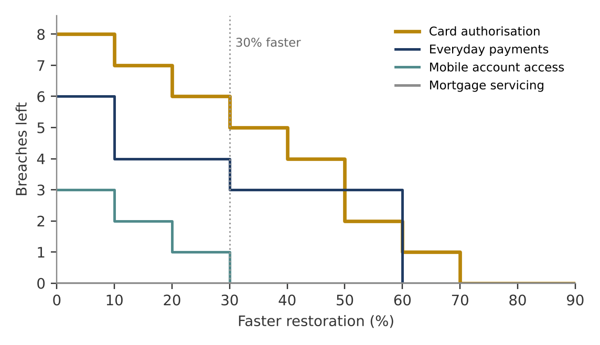
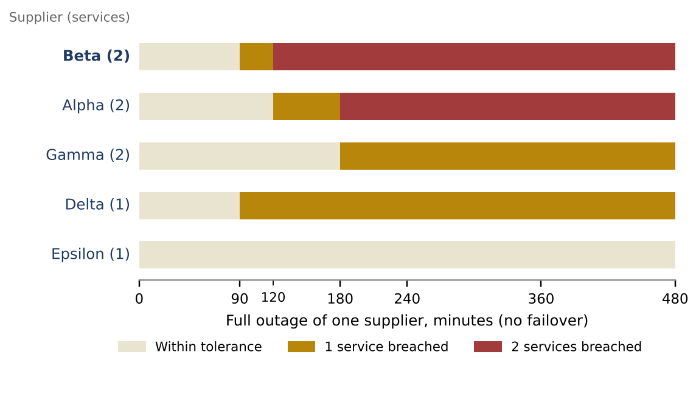

# Recovery exercises: decision paper

**To:** Operational Resilience Committee, fictional UK retail bank
**From:** Vedant Audichya
**Date:** November 2026
**Status:** portfolio exercise. Every incident, supplier, tolerance and exercise effect in this paper is simulated.

## Decision requested

Approve two recovery exercises for the next quarter:

1. a **card authorisation recovery rehearsal**, with a target of restoring service about 30% faster than today;
2. a **Provider Beta outage exercise**, testing whether card authorisation can be restored or failed over inside its 90-minute tolerance while Beta is down.

Payments recovery follows as the second rehearsal. No investment is requested until the exercises have produced timed evidence.

## Why these two

**Card authorisation breaches most often.** Over 24 simulated months it had 13 service-impact episodes, and 8 ran past its 90-minute impact tolerance. Across all four services, 17 of 42 episodes breached.

**About 31% faster restoration would halve its breaches, and that target is stable.** It is 30.8% at the default seed and 31.3% as the median of 50 alternative simulated histories. Everyday payments needs about 26% (31% median). Clearing every breach would take 60% to 70% faster recovery for both services. That is a failover or redundancy design question, not something a rehearsal will deliver.

**Provider Beta is the supplier concentration point.** It supports both payments and card authorisation, the two services with the tightest tolerances, and is rated low substitutability. A full outage longer than 90 minutes takes card authorisation past tolerance; longer than two hours takes both. Provider Alpha also supports two services but gives two hours before the first breach.

**The history alone undervalues Beta.** Beta had no shared outage in the default simulated history, so replaying past incidents gives a shared-provider exercise almost no credit (median 0.5 breaches avoided, zero in 25 of 50 histories). The dependency map shows the exposure that history has not yet revealed. For a rare, high-impact event, structure is the better guide.

## Options compared

Each exercise was tested on the same simulated incidents, assuming eligible episodes become 10%, 30% or 50% shorter. Figures are breaches avoided out of a 17-breach baseline.

| Exercise | Default history (10% / 30% / 50%) | Median of 50 histories at 30% | Histories with no benefit at 30% |
|---|---|---:|---:|
| Card recovery rehearsal | 1 / 3 / 6 | 2 | 6 of 50 |
| Payments recovery rehearsal | 2 / 3 / 3 | 2 | 9 of 50 |
| Shared-provider coordination (any supplier) | 0 / 0 / 0 | 0.5 | 25 of 50 |

Card and payments cannot be separated on this comparison alone; the result follows from the assumed effect. The recovery-gap analysis breaks the tie: card has more breaches, a tighter tolerance and a stable 31% target.

## How each exercise should run

For both exercises, before they start: name an accountable owner, write down the current recovery steps and dependencies, and agree a stop or redesign rule. During the exercise, time detection, escalation, restoration and customer communication separately. Afterwards, record what the team could not do, replace the assumed 30% effect with the measured one, and rerun the comparison.

This follows Sminia's (2026) idea of scenario work as *wayfinding*: rehearse the response the bank already has, notice where it breaks, and only then design something new. The Beta exercise is where a new cross-service arrangement is most likely to be needed.

## What would change this recommendation

- A measured rehearsal that cuts card restoration by much less than 30% would move effort from rehearsal to failover design.
- If Beta has a tested failover that restores card services inside 90 minutes, Alpha becomes the next supplier to examine.
- Real tolerances, real dependency maps and real incident timings replace every number here. The method carries over; the figures do not.

## Limits

The data is generated from stated distributions (generator v1.0, seed 280926). Ranges across seeds describe invented histories, not confidence intervals. The recovery cut is applied evenly to every episode of a service. The supplier stress test assumes a full outage and no failover. Public Open Banking API availability is used as external context only and is never linked to this bank.

**Evidence:** `02_data/simulated_bank_eda_review.md`, `05_modelling/scenario_assumptions.md`, `05_modelling/scenario_run_review.md`, `05_modelling/resilience_gap_review.md`, `07_strategy/scenario_wayfinding.md`, `08_dashboard/resilience_dashboard.xlsx`. Code: github.com/Vedant-Au/uk-bank-operational-resilience-analytics
