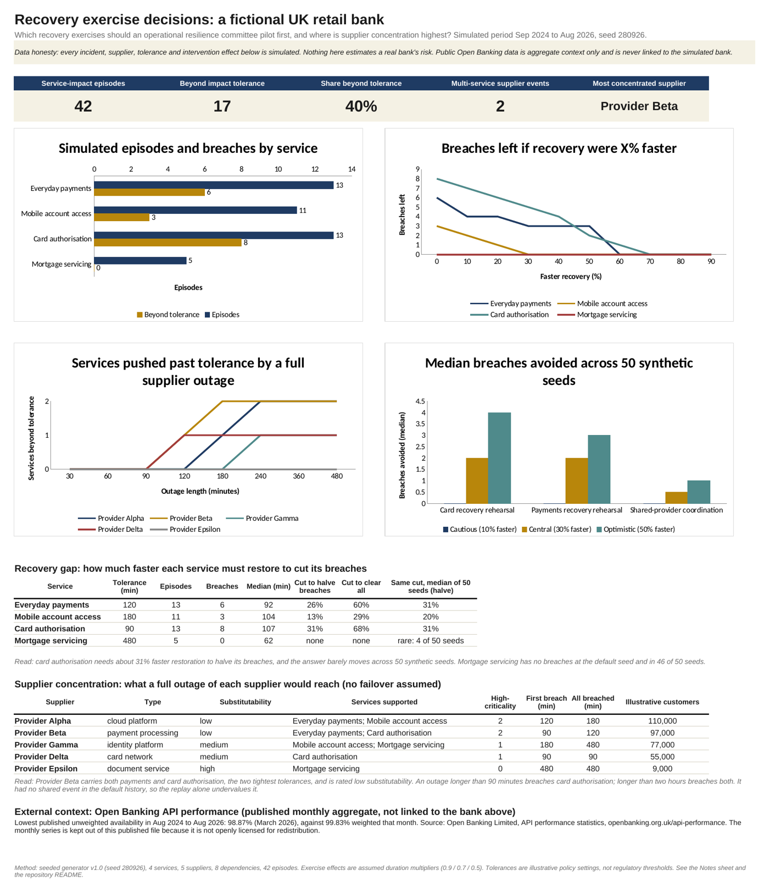

# UK bank operational resilience: which recovery exercises to pilot first

A decision-support project for a **fictional UK retail bank**. It maps four important business services to five suppliers, measures how often simulated incidents run past each service's impact tolerance, and works out which recovery exercises a resilience committee should test first. The framing follows the FCA's operational resilience rules (SYSC 15A: important business services, impact tolerances, mapping and scenario testing).

> **Data honesty.** All bank incidents, suppliers, tolerances and exercise effects are **simulated** by a seeded generator in this repo. Nothing here estimates a real bank's risk. Real Open Banking API performance data is used only as external context and is never joined to the simulated bank.

## The answer

1. **Rehearse card authorisation recovery first.** It breached its 90-minute tolerance in 8 of 13 simulated episodes. Restoring it about **31% faster halves those breaches**, and that target holds across 50 alternative simulated histories (30.8% at the default seed, 31.3% median).
2. **Test a Provider Beta outage specifically.** Beta is the only supplier behind both services with the tightest tolerances (payments and card authorisation). A full outage over 90 minutes breaches card authorisation; over two hours breaches both.
3. **Don't trust the incident replay alone for supplier risk.** Beta had no shared outage in the simulated history, so replaying past incidents gives a supplier exercise almost no credit (median 0.5 breaches avoided). The dependency map shows the exposure the history has not revealed yet.

Full reasoning: [committee paper (PDF, 2 pages)](09_report/committee_brief.pdf) · [one-pager](one-pager.pdf)

## Dashboard

[`08_dashboard/resilience_dashboard.xlsx`](08_dashboard/resilience_dashboard.xlsx): every figure is an Excel formula over the data sheets. A Tableau Public version is in progress.



## What I built

| Layer | What it does | Where |
|---|---|---|
| Warehouse | PostgreSQL schemas `raw`, `stg`, `core`, `mart`; source batches with SHA-256, typed staging, fact and dimension tables, mart views, quality checks | `03_sql/` |
| Public data intake | Parses the Open Banking historical CSV (20 metrics x 25 months), checks month sequence, ranges and that failed calls = business + technical failures in every month | `04_etl/ingest_open_banking.py` |
| Simulated bank | Seeded generator: 4 services, 5 suppliers, 8 dependencies, 24 months, 42 service-impact episodes incl. 2 multi-service supplier events; validator and idempotent loader | `04_etl/` |
| Question gate | Candidate questions scored only after both data layers were profiled | `06_research_question/` |
| Exercise comparison | Paired replay of three recovery exercises under cautious / central / optimistic effects, across 50 seeds | `05_modelling/compare_exercises.py` |
| Recovery gap and supplier stress | Cut in restoration time each service needs; what a full outage of each supplier would reach | `05_modelling/resilience_gaps.py` |
| Decision products | Excel dashboard, committee paper, one-pager | `08_dashboard/`, `09_report/` |

Tests: `python3 -m unittest discover -s 05_modelling -p 'test_*.py'` (7 tests).

## Results in two tables

**Recovery gap** (default seed; median of 50 seeds in brackets)

| Service | Tolerance | Breaches | Cut to halve breaches | Cut to clear all |
|---|---:|---:|---:|---:|
| Card authorisation | 90 min | 8 / 13 | 30.8% (31.3%) | 68.1% (68.2%) |
| Everyday payments | 120 min | 6 / 13 | 25.5% (30.9%) | 59.8% (59.6%) |
| Mobile account access | 180 min | 3 / 11 | 13.1% (19.9%) | 28.6% (40.6%) |
| Mortgage servicing | 480 min | 0 / 5 | none | none |

**Exercise comparison** (breaches avoided out of 17; eligible episodes assumed 30% shorter)

| Exercise | Default seed | Median of 50 seeds | Seeds with no benefit |
|---|---:|---:|---:|
| Card recovery rehearsal | 3 | 2 | 6 |
| Payments recovery rehearsal | 3 | 2 | 9 |
| Shared-provider coordination | 0 | 0.5 | 25 |

Card and payments tie on the comparison because the effect is assumed. The recovery-gap analysis breaks the tie. Details: [`05_modelling/resilience_gap_review.md`](05_modelling/resilience_gap_review.md) and [`05_modelling/scenario_run_review.md`](05_modelling/scenario_run_review.md).

## Run it

Python 3.10+ only, no database needed:

```bash
pip install -r requirements.txt
bash run_pipeline.sh
```

This regenerates the simulated bank (seed 280926), reruns both analyses, exports the dashboard data, rebuilds the Excel dashboard and runs the tests. The PostgreSQL warehouse is optional; see [`docs/setup.md`](docs/setup.md).

## Repository map

```
01_business_context/   scope, decisions, regulatory framing
02_data/               source register, data profiles, EDA reviews, simulation design
03_sql/                PostgreSQL schema, quality and EDA queries
04_etl/                Open Banking parser, simulated-bank generator and loader
05_modelling/          exercise comparison, recovery gap, supplier stress, tests, assumptions
06_research_question/  how the question was chosen
07_strategy/           Sminia (2026) wayfinding lens used for the recommendations
08_dashboard/          dashboard data (simulated), Excel dashboard and its build script
09_report/             committee paper
```

## Limits

- Simulated data shows how the method works; it is not a finding about any real bank or supplier.
- Ranges across seeds describe invented histories, not confidence intervals.
- Exercise effects are assumed duration multipliers (0.9 / 0.7 / 0.5); a real exercise would replace them with timed results.
- The recovery cut is applied evenly to every episode; the supplier stress test assumes a full outage and no failover.
- Impact tolerances are illustrative policy settings. The FCA requires firms to set their own; it does not set the numbers.

## Sources

- FCA, [Operational resilience](https://www.fca.org.uk/firms/operational-resilience) and [SYSC 15A](https://handbook.fca.org.uk/handbook/SYSC/15A/).
- Open Banking Limited, [API performance statistics](https://www.openbanking.org.uk/api-performance/) (historical CSV, Aug 2024 to Aug 2026). Not redistributed here: the publisher's terms reserve all rights and no open data licence applies. Download it yourself and run `08_dashboard/export_dashboard_data.py --open-banking-csv <file>` to add the public panel locally.
- Sminia, H. (2026). From scenario thinking to scenario doing: strategic management as wayfinding. *Futures & Foresight Science*, 8, e70038. https://doi.org/10.1002/ffo2.70038

*Vedant Audichya · MSc Business Analysis & Consulting, University of Strathclyde · November 2026*
